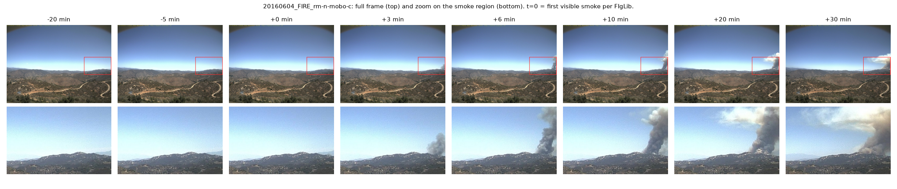
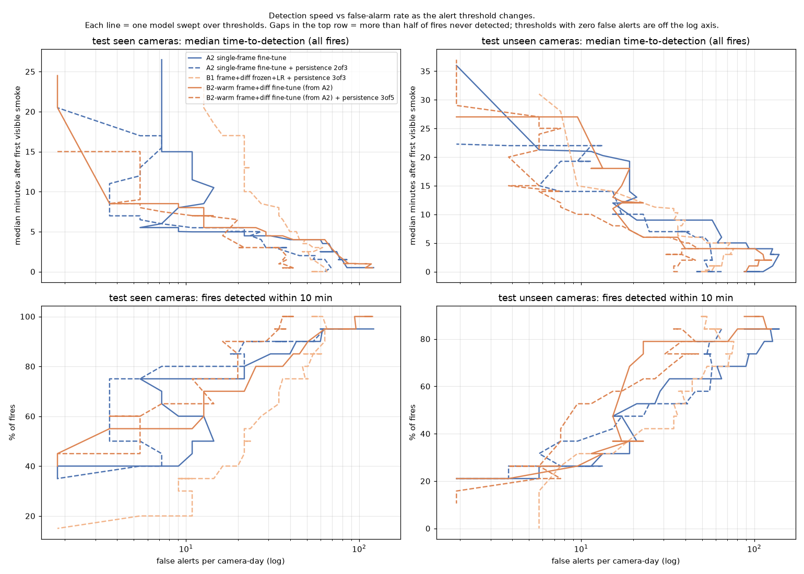
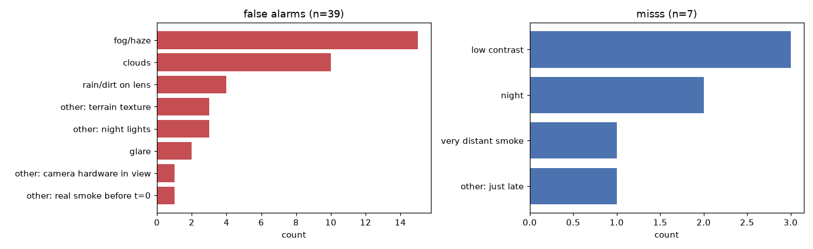

# Early wildfire smoke detection from mountaintop cameras

## The problem

A wildfire reported in its first few minutes can often be handled by one engine company. The same
fire found half an hour later, in wind, can need hundreds of firefighters. Fixed cameras on mountain
tops already watch most of Southern California's back country, but no one can stare at hundreds of
feeds all day. A detector has to do two things at once: raise the alarm within minutes of the first
wisp of smoke, and stay quiet the rest of the time, because operators stop trusting a system that
pages them for clouds. This project measures both in operational units, **minutes until the first
alert** and **false alerts per camera per day**, and tests whether looking at *change over time*
beats looking at single frames.



## Approach in one paragraph

110 whole fire sequences from 69 tower cameras (HPWREN FIgLib; one frame per minute, 40 minutes
either side of the first visible smoke). Each frame is cut into 40 overlapping 224x224 tiles so
early, tiny plumes keep their pixels. A MobileNetV3-Large backbone scores every tile; a frame alerts
if any tile crosses a threshold. Training uses only frame labels (smoke after t=0), via
multiple-instance learning. Splits are by fire day, and a separate test set uses camera sites never
seen in training. Models compared: single frame (A), frame plus a difference image vs the previous
frame (B), and a "K of the last N frames" persistence rule on top of each.

## Results

Test sets: **20 fires on cameras seen in training** and **19 fires on 7 held-out camera sites**.
Threshold chosen on validation (best frame F1) and then frozen. "Minutes" = after FIgLib's first
visible smoke (t=0), with misses counted as never. False alerts: 95% bootstrap interval in brackets,
measured on only about 13 smoke-free camera-hours per test set, so treat them as indicative.
Latency: full frame (decode, 40 tiles, model), FP32 ONNX Runtime on a laptop CPU (Ryzen 9 8945HS).
All numbers are written by `scripts/p9_readme_table.py` from `results/*.json`.

<!-- RESULTS-TABLE:START -->
| Model | Cameras | Median minutes to detection | Fires detected within 10 min | False alerts per camera-day | Frame PR-AUC | CPU ms per frame (median, end to end) |
|---|---|---|---|---|---|---|
| A2: single frame | seen (20 fires) | 4.0 | 90% | 41.7 [19.9-66.9] | 0.857 | 121 |
| A2: single frame | unseen (19 fires) | 5.0 | 68% | 95.4 [42.1-153.2] | 0.795 | 121 |
| A2 + persistence (2 of 3) | seen (20 fires) | 6.0 | 80% | 7.2 [0.0-16.4] | 0.863 | 121 |
| A2 + persistence (2 of 3) | unseen (19 fires) | 7.0 | 53% | 32.4 [13.3-53.4] | 0.793 | 121 |
| B2-warm: frame + difference | seen (20 fires) | 1.0 | 100% | 101.4 [57.7-152.7] | 0.889 | 209 |
| B2-warm: frame + difference | unseen (19 fires) | 2.0 | 84% | 116.3 [67.2-169.8] | 0.806 | 209 |
| B2-warm + persistence (3 of 5) | seen (20 fires) | 3.0 | 90% | 34.4 [18.0-53.9] | 0.891 | 209 |
| B2-warm + persistence (3 of 5) | unseen (19 fires) | 3.0 | 74% | 38.1 [19.2-59.1] | 0.810 | 209 |
<!-- RESULTS-TABLE:END -->

**The key trade-off** (each line sweeps one model's alert threshold):



What the numbers say:
- **Fine-tuning matters most.** Frozen ImageNet features with a linear classifier barely beat chance
  at the frame level; fine-tuned tiles do far better (`results/p4_*.json`).
- **Time helps where it counts.** Adding a difference image gave a large gain to the frozen model.
  After fine-tuning, single-frame and temporal models are within each other's confidence intervals
  on frame PR-AUC, but on **unseen cameras** the temporal model catches more fires within 10 minutes
  at the same false-alarm rate. Change information transfers to new views better than appearance.
- **Persistence is the cheapest win**: requiring 2-3 positive frames out of the last 3-5 cuts false
  alerts several-fold for a delay of a minute or two.
- **The hard part is false alarms.** At a strict budget (at most 1 false alert per camera-day on
  validation), every model misses most fires. Haze and clouds cause most false alerts:



- **Speed is not a problem.** A frame takes well under a second on one laptop CPU, against one frame
  per minute from the camera. Simple INT8 quantisation shrank the model but hurt accuracy badly for
  almost no speed gain, so FP32 is the deployable version here (`results/p8_edge.json`).
  TensorRT was not tested (not installed; it would not fit the storage budget). No Jetson or other
  edge-device numbers were measured or are claimed.

## Limitations

- **Label noise.** t=0 is when a human first saw the plume, not ignition. Smoke can be invisible for
  minutes after t=0 (one boxed fire was not measurably visible for 22 minutes), and one "false
  alarm" in the review was a genuine plume before the labelled t=0.
- **Little negative data.** False alerts per day rest on about 13 smoke-free camera-hours per test
  set, all from the 40 minutes before fires (fire weather, mostly daytime). Real deployments see
  nights, fog seasons and rain that are under-represented here.
- **Small test sets** (19-20 fires each): confidence intervals are wide and overlap between the best
  models.
- **One region.** All cameras are HPWREN sites in Southern California; different vegetation, haze and
  camera hardware elsewhere would shift results.
- **Compute choices.** Frames were downscaled 2x to fit a 10 GB budget, training was short (3-5
  epochs), and latency was measured on a laptop CPU only.

## What I'd do next

1. Hard-negative mining on haze and cloud days, plus longer temporal context (a short clip instead
   of one difference image), to cut the two biggest false-alarm sources.
2. Many more smoke-free hours per camera to measure false alerts per day properly, and per-camera
   masks for static artefacts (mast, lights, lens dirt).
3. Higher-resolution tiles near the horizon for distant smoke; a separate night model.
4. Quantisation-aware training (or partial INT8) and measurement on a real edge device.

## Data

| | |
|---|---|
| Dataset | HPWREN Fire Ignition images Library (FIgLib), https://www.hpwren.ucsd.edu/FIgLib/ |
| Download | per-sequence `.tgz` from https://cdn.hpwren.ucsd.edu/HPWREN-FIgLib-Data/Tar/index.html (verified Nov 2026) |
| Format | JPEG frames named `<unix timestamp>_<offset seconds from first visible smoke>.jpg`, about one per minute, 40 min either side of t=0 |
| Labels used | frame labels from the offset sign; bounding boxes (CSV: `MinX,MinY,MaxX,MaxY,Filename`) for 9 sequences from `.../Miscellaneous/Labels/HPWREN-BB/CSV/` |
| What we kept | 110 sequences (list, cameras, frame counts and archive sizes in `results/p1_download.json`; split membership in `results/p2_splits.json`), downscaled to 1536 px wide; originals deleted after processing |
| License | Archived HPWREN data, including FIgLib: **CC BY-NC 4.0** (non-commercial use with attribution). The images are not redistributed in this repository; only small derived figures. |
| Considered, not used | Pyronear `pyro-sdis` (Apache-2.0, YOLO boxes, French cameras): kept out so the camera-shift question stays within one data source |

**Attribution:** Data courtesy of HPWREN, University of California San Diego
(https://www.hpwren.ucsd.edu/).

**Citation:** Dewangan, A., et al. (2022). FIgLib & SmokeyNet: Dataset and Deep Learning Model for
Real-Time Wildland Fire Smoke Detection. *Remote Sensing*, 14(4), 1007.

## License

- **Code** (`src/`, `scripts/`): MIT, see [`LICENSE`](LICENSE).
- **Figures and data-derived results** (`figures/`, `results/`): contain or are derived from HPWREN
  FIgLib imagery and are licensed **CC BY-NC 4.0** (non-commercial, attribution required).
- **Raw images, bounding boxes and model weights are not redistributed**; the scripts download the
  data from HPWREN and the pretrained weights through torchvision.

Full details and attributions: [`NOTICE.md`](NOTICE.md).

## Repository

`src/` shared code · `scripts/` one script per step · `results/` every number (JSON) ·
`figures/` all plots · `data/` (gitignored) holds the downloaded frames, features and weights.

## Reproduce

Run from the repository root, in this order. Every script writes `results/<name>.json`.

```bash
uv venv --python 3.12 .venv
uv pip install --python .venv/Scripts/python.exe -r requirements.txt
python scripts/p0_environment.py                 # machine info
python scripts/p1_download.py --n 110            # sample, download, downscale, delete originals
python scripts/p1_audit.py                       # dataset audit + figures
python scripts/p2_splits.py                      # labels, label noise, leakage demo, splits
python scripts/p3_preprocess.py                  # tiling/normalisation/differencing figures + alignment
python scripts/p4_features.py                    # frozen MobileNetV3 tile embeddings
python scripts/p4_backbone_choice.py             # MobileNetV3 vs EfficientNet-B0 on this CPU
python scripts/p4_frozen_lr.py --name p4_A1_frozen_lr --features cur
python scripts/p4_finetune.py  --name p4_A2_finetune --mode single
python scripts/p4_frozen_lr.py --name p5_B1_frozen_lr_diff --features cur diff_al
python scripts/p4_frozen_lr.py --name p5_B1_frozen_lr_diff_noalign --features cur diff_raw
python scripts/p4_finetune.py  --name p5_B2_finetune_diff --mode temporal
python scripts/p4_finetune.py  --name p5_B2w_finetune_diff_warm --mode temporal \
       --init-from p4_A2_finetune --epochs 3 --lr 1e-4 --batch-frames 4
python scripts/p5_temporal.py                    # comparison + persistence rule
python scripts/p6_operational.py                 # time-to-detection, false alerts/day, sweeps
python scripts/p7_gallery.py --model "p5_B2w_finetune_diff_warm+persist3of5" --op f1
python scripts/p7_summary.py                     # counts from results/p7_error_labels.csv (manual review)
python scripts/p8_export.py                      # ONNX, INT8, CPU latency
python scripts/p9_readme_table.py                # fills the results table above
```

On Linux/macOS use `.venv/bin/python`. The GPU is used when present; everything also runs on a CPU,
just slower (fine-tuning especially).
